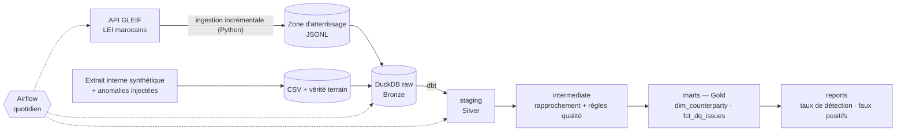

# Counterparty Data Platform

[](https://github.com/ouchchenomar/counterparty-data-platform/actions/workflows/ci.yml)


> Référentiel contrepartie gouverné : ingestion incrémentale des LEI publiés par GLEIF,
> règles qualité testées sur une vérité terrain, quarantaine et golden record.
> Python · dbt · DuckDB · Airflow · GitHub Actions.

## Le problème

Avant d'ouvrir une relation avec une contrepartie, une salle des marchés doit s'appuyer sur des
données de référence fiables : identité légale, LEI, pays. Quand ces informations arrivent par
plusieurs canaux, on accumule des doublons, des identifiants invalides et des incohérences, sans
savoir quelle version fait foi.

Ce projet confronte un extrait « interne » de contreparties au référentiel officiel GLEIF. Il mesure
la qualité de chaque fiche, isole les fiches non conformes et construit une version de référence
par contrepartie (golden record).

*Contexte : le projet reprend, sur des données publiques, des problématiques rencontrées pendant
mon PFE en salle des marchés. Il ne contient aucune donnée ni aucun code d'entreprise.*

## Architecture



| Couche | Modèle | Rôle |
|---|---|---|
| raw (Bronze) | `raw.gleif_lei_records`, `raw.internal_counterparties` | Fichiers chargés tels quels, rechargés à chaque run (idempotent) |
| staging (Silver) | `stg_gleif__lei_records` | Parsing JSON, dernière version de chaque LEI |
| | `stg_internal__counterparties` | Nettoyage : espaces, majuscules, vides en NULL, types |
| intermediate | `int_counterparties__matched` | Rapprochement exact sur le LEI |
| | `int_counterparties__dq_checks` | Une colonne booléenne par règle qualité |
| marts (Gold) | `fct_dq_issues` | Une ligne par règle non respectée, enrichie par le catalogue |
| | `dim_counterparty` | Golden record, score qualité, quarantaine |
| reports | `rpt_dq_detection`, `rpt_dq_false_positives` | Taux de détection et faux positifs |

## Données

| Source | Contenu |
|---|---|
| [API GLEIF](https://www.gleif.org/en/lei-data/gleif-api) | Entités dont le siège légal est au Maroc. Données publiques (licence CC0), sans clé d'API. |
| Extrait interne (généré) | Une fiche par entité GLEIF, puis 25 % d'anomalies injectées (une au plus par fiche) et 5 % de doublons. Graine fixe, donc reproductible. La liste des anomalies sert de vérité terrain. |
| `data/sample/gleif_sample.jsonl` | 40 enregistrements GLEIF versionnés pour la CI et le travail hors ligne. |

## Règles qualité

Les règles sont décrites dans un catalogue versionné ([`dbt/seeds/dq_rule_catalog.csv`](dbt/seeds/dq_rule_catalog.csv)) :
dimension, sévérité, caractère bloquant et anomalie que chaque règle doit détecter.

| Règle | Dimension | Bloquante | Vérifie |
|---|---|---|---|
| `chk_mandatory_fields` | complétude | oui | Raison sociale, ville et pays renseignés |
| `chk_lei_present` | complétude | oui | LEI renseigné |
| `chk_lei_format` | validité | oui | 18 caractères alphanumériques puis 2 chiffres (ISO 17442) |
| `chk_lei_checksum` | validité | oui | Clé de contrôle ISO 7064 MOD 97-10, calculée en SQL ([`macros/lei.sql`](dbt/macros/lei.sql)) |
| `chk_lei_known` | cohérence | oui | LEI présent dans GLEIF |
| `chk_country_consistent` | cohérence | non | Pays interne identique au pays du siège GLEIF |
| `chk_not_duplicate` | unicité | oui | Une seule fiche par LEI |

## Résultats

*Run du 22/10/2026 sur les données GLEIF réelles. À relancer et mettre à jour.*

- **211 LEI marocains** ingérés en 2 pages d'API. Le run incrémental suivant n'a relu qu'un enregistrement (chevauchement d'un jour, dédoublonné en staging).
- **222 fiches internes**, dont **64 anomalies injectées : 64 détectées par la règle prévue, 0 faux positif.**
- **211 contreparties** dans le golden record, dont **43 en quarantaine** pour une anomalie bloquante.
- **49 nœuds dbt** (1 seed, 9 modèles, 39 tests) et **17 tests pytest**, exécutés à chaque push.
- Constat sur la source : **83 des 211 LEI marocains (39 %) ont le statut `LAPSED`**, c'est-à-dire non renouvelés. C'est la prochaine règle à ajouter.

> Le taux de 100 % est attendu : les règles sont conçues pour les anomalies injectées. Il sert de
> test de non-régression ([`assert_all_injected_anomalies_detected`](dbt/tests/assert_all_injected_anomalies_detected.sql)).
> L'intérêt est ailleurs : ce que les règles révèlent sur la donnée réelle.

## Lancer le projet

### En local (Windows, macOS, Linux)

```bash
python -m venv .venv
# Windows : .venv\Scripts\activate    macOS/Linux : source .venv/bin/activate
pip install -e ".[dev]"

python -m cdp.pipeline --from-sample   # hors ligne, sur l'échantillon
python -m cdp.pipeline                 # données réelles GLEIF, incrémental après le premier run
```

Sous Windows, si `pip install` échoue sur un chemin trop long, placez le projet dans un dossier
court ou activez la prise en charge des chemins longs.

Pour explorer les résultats :

```python
import duckdb

con = duckdb.connect("data/warehouse/cdp.duckdb", read_only=True)
print(con.sql("select * from reports.rpt_dq_detection"))
print(con.sql("select * from marts.dim_counterparty where is_quarantined limit 10"))
```

### Avec Airflow (Docker)

```bash
docker compose up --build -d
```

Ouvrez http://localhost:8080 (pas d'écran de connexion en local), puis activez le DAG
`cdp_counterparty_pipeline` : `ingest_gleif → ensure_internal_extract → load_raw → dbt_build`,
une fois par jour. On peut aussi le déclencher en ligne de commande :

```bash
docker compose exec airflow airflow dags trigger cdp_counterparty_pipeline
```

Le premier build prend quelques minutes, pour une image d'environ 2,7 Go (Airflow et le venv
dbt). Testé le 22/10/2026 avec Airflow 3.3.2 : un run complet dure environ 25 secondes.
Le code et les données sont montés depuis le dossier du projet, ce qui évite de reconstruire
l'image après une modification. Pour arrêter : `docker compose down`.

### Qualité du code

```bash
ruff check .
pytest
```

La CI ([`.github/workflows/ci.yml`](.github/workflows/ci.yml)) lance le lint, les tests unitaires
puis le pipeline complet sur l'échantillon, dbt compris.

## Décisions techniques

- [ADR 0001 — DuckDB en local et en CI, BigQuery pour la version cloud](docs/adr/0001-duckdb-local-bigquery-cloud.md)
- [ADR 0002 — Ingestion incrémentale avec filigrane et chevauchement](docs/adr/0002-ingestion-incrementale-chevauchement.md)

## Feuille de route

- [x] Ingestion incrémentale GLEIF (filigrane, reprises automatiques, chevauchement)
- [x] Générateur synthétique avec vérité terrain
- [x] Staging, rapprochement, 7 règles qualité, golden record et quarantaine
- [x] Taux de détection, faux positifs et test de non-régression
- [x] CI : ruff, pytest, pipeline complet hors ligne
- [ ] Règle « LEI non renouvelé » (`LAPSED`)
- [ ] Rapprochement approché sur la raison sociale pour les fiches sans LEI
- [ ] Snapshot SCD2 de `dim_counterparty` (historique des changements)
- [ ] `fct_dq_issues` en incrémental (historique des anomalies)
- [ ] Version cloud : target BigQuery (voir `dbt/profiles.yml`)
- [ ] Page qualité (Streamlit) : score par segment, fiches en quarantaine
- [ ] Documentation dbt en ligne (workflow prêt : activer GitHub Pages)

## Limites

- L'extrait interne est synthétique : le taux de détection mesure la cohérence entre règles et
  anomalies, pas une performance sur des données bancaires réelles.
- DuckDB n'accepte qu'un écrivain à la fois, ce qui suffit à ce volume. En production, on
  utiliserait un entrepôt partagé (BigQuery, Snowflake, PostgreSQL).
- Airflow tourne en mode `standalone`, réservé au développement local.

## Auteur

Omar Ouchchen — Data Engineer junior · [LinkedIn](https://www.linkedin.com/in/omar-ouchchen-11b579221)
